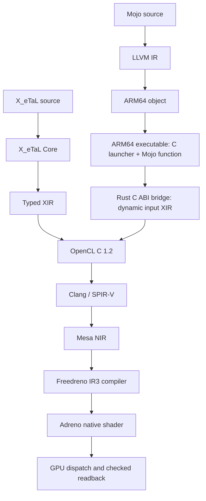

# X_eTaL and Mojo to running code on Adreno 702

Both paths now execute on the UNO Q's physical Qualcomm FD702 GPU through
Mesa rusticl. Five X_eTaL programs passed all 71 output checks. A
cross-compiled Mojo host function ran threshold/ReLU through the same
OpenCL emitter/runtime and matched all 24 Float outputs against both its
own reference calculation and X_eTaL's saved evaluator baseline.

The important boundary: the Mojo function runs on the ARM CPU and requests
GPU work through a C ABI. It is not a native Mojo GPU kernel compiled to
Adreno instructions. The GPU kernel is generated OpenCL C in both paths.



## Hardware and proof of execution

The board is Debian 13.1 aarch64, glibc 2.41, with 1.7 GiB usable RAM.
OpenCL reports platform `rusticl`, device `FD702`, vendor `Qualcomm`, type
GPU, driver `25.2.6-1~bpo13+1`, and no fp64. The tool selects this device
explicitly; there is no CPU fallback. Vulkan's separate llvmpipe device is
not used. See [the inventory](uno-q-capabilities.md).

[The X_eTaL run transcript](evidence/unoq-xetal-opencl-20261023/demo.log)
shows source, evaluator output, Adreno output and comparison for threshold,
vector-add, SAXPY, reductions and pipeline. The device event profiling and
Mesa compiler debug output accompany actual dispatch/readback. These small
examples prove execution and agreement, not a throughput advantage.

## 1. X_eTaL source and its evaluator oracle

The [captured source](evidence/unoq-xetal-opencl-20261023/threshold.xtl)
imports Accel and prints five results:

```text
"ac:" u_se< "Accel"
x := ((r_ange 8) / 4) - 1.0
x
0.5 ac:t_hreshold x
ac:r_elu x
n := (r_ange 8) - 4
ac:r_elu n
(n m_od 2) ac:k_eep n
```

X_eTaL's range here is 1 through 8. The first three vectors are:

```text
-0.75 -0.5 -0.25 0.0 0.25 0.5 0.75 1.0
-0.0 -0.0 -0.0 0.0 0.0 0.0 0.75 1.0
0.0 0.0 0.0 0.0 0.25 0.5 0.75 1.0
```

These are the input, threshold at 0.5, and ReLU. The final two outputs test
Int ReLU and signed remainder/mask semantics. The oracle is the pinned
upstream evaluator's [regression output](evidence/unoq-xetal-opencl-20261023/threshold.expect),
not an expected result invented by the GPU emitter.

## 2. Core, typed XIR and fusion

The existing front end assembles imports and lowers X_eTaL to Core through
`xetal_program::load`. X_eTaL-gpu evaluates this Core structurally to form
XIR: library calls are inlined, known ranges/shapes become constants, and
device arithmetic becomes typed nodes. Unsupported operations are refused
or explicitly evaluated by the host; not every X_eTaL operation is a GPU
operation. The [exact loaded Core](evidence/unoq-deep-dive-20261023/threshold.core)
starts with `(def LA:t_hreshold (lam t (lam x (app2 #* x (app #f_loat
(app2 #> x t))))))`: the namespaced library function becomes nested
lambdas and primitive applications. The [assembled import sources](evidence/unoq-deep-dive-20261023/threshold.combined.xtl)
are captured too. The dump helper uses the same pinned `xetal_program::load`
entry point that the GPU lowerer consumes.

The [complete captured XIR](evidence/unoq-xetal-opencl-20261023/threshold.xir)
contains these actual instructions:

```text
%l = const f64 [8] 1.0 2.0 3.0 4.0 5.0 6.0 7.0 8.0
%r = const f64 [] 4.0
%div = map div %l %r
%r_2 = const f64 [] 1.0
%sub = map sub %div %r_2
%r_3 = const f64 [] 0.5
%gt = map gt %sub %r_3
%f = cast f64 %gt
%mul = map mul %sub %f
%r_4 = const f64 [] 0.0
%max = map max %sub %r_4
```

Names identify values, `[]` denotes a scalar, and `[8]` an eight-element
vector. The comparison produces a Bool, the cast converts it to a numeric
mask, and multiplication implements threshold. ReLU is a separate maximum.
The full file also contains the Int path and names all five outputs.

XIR retains X_eTaL's f64 semantic type. The selected schedule computes
Floats as f32 on this no-fp64 device, while Ints use i64. Consecutive maps
of one shape fuse into one OpenCL kernel; SSA-like XIR temporaries become
register expressions rather than individually uploaded arrays.

## 3. Generated OpenCL C

The [actual generated kernel](evidence/unoq-xetal-opencl-20261023/threshold.cl)
starts as follows (the Int path follows in that file):

```c
__kernel void k0(__global const float* b_l, __global const long* b_l_2,
                __global float* b_sub, __global float* b_mul,
                __global float* b_max, __global long* b_max_2,
                __global long* b_mul_2) {
    size_t i = get_global_id(0);
    if (i >= 8) return;
    float t_div = (b_l[i] / 4.0f);
    float t_sub = (t_div - 1.0f);
    int t_gt = (t_sub > 0.5f);
    float t_f = (float)t_gt;
    float t_mul = (t_sub * t_f);
    float t_max = fmax(t_sub, 0.0f);
    // Int calculations and output stores omitted here; see linked artifact.
}
```

The bounds guard matters because the launch is rounded up to a workgroup.
All five results are written by the fused kernel. The helpers in the full
source implement X_eTaL's floored integer division/remainder, including
negative inputs; C's ordinary signed remainder is not substituted.

The default 256-item group passed maps but failed the reduction suite:
`reduce_max_long` permits at most 192 work-items on FD702. The tested
[Adreno schedule](../schedules/adreno-702.toml) uses 128, a power of two below
that kernel-specific limit. A device-wide 512 limit is not enough to choose
the reduction launch size.

## 4. The driver's binary container and SPIR-V

`xetal-gpu binary ... --device opencl:0 --schedule ... --out ...` asks the
driver for `CL_PROGRAM_BINARIES`. It reports one `k0` kernel and binary type
`executable`, but those API words do not establish that the returned bytes
are Adreno machine instructions.

The captured threshold program is 7781 bytes and starts with:

```text
72 75 73 74 69 63 6c 00 01 00 00 00 05 00 00 00
48 1e 00 00 04 00 00 00 46 44 37 30 32 03 02 23
07 ...
```

The first eight bytes spell `rusticl\0`. An embedded SPIR-V magic begins
at byte offset 29; the remaining 7752 bytes disassemble as SPIR-V 1.4.
`FD702` occupies the five bytes immediately preceding the SPIR-V. The
four little-endian header words are 1, 5, 7752 and 4. Version, device-name
length, payload length and OpenCL executable-type are consistent
interpretations of those values; the byte layout is observed directly.

The disassembly declares:

```text
OpCapability Addresses
OpCapability Kernel
OpCapability Int64
OpMemoryModel Physical64 OpenCL
OpEntryPoint Kernel %2 "k0" %__spirv_BuiltInGlobalInvocationId
OpSource OpenCL_C 102000
```

This is OpenCL-kernel SPIR-V with physical pointers, not Vulkan shader
SPIR-V. The linked module preserves `OpFMul` for the threshold mask and
`OpExtInst ... fmax` for ReLU, plus helper functions for signed Int semantics.
The package is an intermediate representation that rusticl can reload;
the final Adreno machine code appears later. Validation must use an
environment that accepts its SPIR-V version; OpenCL 1.2 validation alone
rejects the 1.4 module, even though the device accepted the OpenCL C source.

## 5. Mesa NIR and final Adreno shader

The diagnostic replay uses `MESA_SHADER_CACHE_DISABLE=true`,
`RUSTICL_DEBUG=nir` and `IR3_SHADER_DEBUG=disasm`. Mesa prints NIR after
SPIR-V conversion, further lowering stages, final NIR and native shader
disassembly. The diagnostic run's outputs are checked against the same
oracle. See [Mesa's debug variables](https://docs.mesa3d.org/envvars.html)
and [Freedreno documentation](https://docs.mesa3d.org/drivers/freedreno.html).

The early NIR retains a global invocation ID and uniform pointer arguments.
The final NIR lowers addressing and stores to operations such as
`pack_64_2x32_split` and `@store_global_ir3`. Those are driver compiler IR,
not instructions that the CPU executes.

The native dump contains these actual Adreno instructions:

```text
@const(c16.x) 0x0000ffff, 0x3e800000, 0xbf800000, 0x00000000
...
cmps.u.lt p0.x, r0.y, 8
...
```

The constants include IEEE Float32 0.25 (`0x3e800000`), -1.0
(`0xbf800000`) and 0.0. The unsigned comparison against eight implements
part of the bounds condition. This is machine-specific shader disassembly;
it must not be confused with the ARM64 instructions in the Mojo launcher.

The full threshold includes 64-bit signed remainder, which expands into
many 32-bit arithmetic and selection instructions. It is consequently
larger than its Float-only threshold/ReLU portion. Mesa prints two native
variants in this capture, with its own statistics: 328 and 311 instruction
entries, and 576 and 544 dwords respectively. Variant statistics describe
this driver build and specialization; they are not a portable cost model.
The [full native disassembly](evidence/unoq-deep-dive-20261023/xetal-native.disasm)
and [all NIR stages](evidence/unoq-deep-dive-20261023/xetal-mesa-debug.log)
are captured. These exact Float-path instructions map directly to source:

| Actual Adreno instruction | Role in this kernel |
| --- | --- |
| `(sy)mul.f r3.w, r3.w, c16.y` | Multiply by 0.25: source division by four becomes multiplication |
| `add.f r3.w, r3.w, c16.z` | Add -1.0 to form x |
| `cmps.f.lt hr3.z, (0.5), r3.w` | Test 0.5 < x, equivalent to x > 0.5 |
| `cov.u16f32 (even)r2.x, hr3.z` | Convert the comparison result into a Float mask |
| `mul.f r2.x, r3.w, r2.x` | Multiply x by the mask for threshold |
| `max.f r3.w, r3.w, (0.0)` | ReLU |
| `stg.u32 g[r5.x], r2.x, 1` | Store one 32-bit threshold element |
| `stg.u32 g[r2.w], r3.w, 1` | Store one 32-bit ReLU element |

The `(sy)`, `(ss)`, `(nopN)` and repeated-nop annotations express
hardware scheduling/synchronization around these instructions. They are
not X_eTaL-level operations. Large amounts of address arithmetic and the
Int remainder path surround this short Float sequence.

## 6. Mojo source, LLVM IR, ARM64 object and executable

The [Mojo source](../mojo/threshold.mojo) exports `mojo_adreno_demo` using
the C ABI. It fills the same eight Float inputs, computes its own threshold
and ReLU reference, calls `adreno_threshold_v1`, and checks all 24 returned
elements. C supplies storage; Mojo orchestrates the computation and checks.

```text
Mojo source
  -> LLVM IR (captured compiler output)
  -> ARM64 relocatable ELF object, target cortex-a53
  -> ARM64 GCC link with C launcher and Rust bridge
  -> dynamically linked ARM64 Linux executable
```

The exported object has one unresolved application symbol:

```text
U adreno_threshold_v1
```

The final executable needs `libadreno_mojo_opencl.so` and `libc.so.6`, with
RUNPATH `$ORIGIN/../lib`. It does not need the standard Mojo runtime. The
[ARM64 disassembly](evidence/unoq-deep-dive-20261023/mojo-adreno.disasm)
shows the call boundary to the OpenCL bridge. Selected addresses from the
actual executable:

| Address / instruction | Annotation |
| --- | --- |
| `b80: cmp x3, #0x8` | Require the eight-element fixture |
| `bbc: ucvtf s4, x8, #2` | Convert i+1 to Float and scale by 2^-2 |
| `bc0: fadd s4, s4, s0` | Add -1.0 to form x on the CPU |
| `bc4: fcmp s4, s1` | Compare against the 0.5 threshold |
| `bd4: fcsel s5, s3, s2, gt` | Select 1.0 or 0.0 for the reference mask |
| `bdc: fmul s5, s4, s5` | Compute expected threshold on the CPU |
| `bf8: bl 7b0 <adreno_threshold_v1@plt>` | Call the Rust OpenCL bridge |
| `c08: fcmp s0, s1` | Compare a returned value against Mojo's reference |
| `c0c: cinc w0, w0, ne` | Count mismatches |

This is CPU code that requests GPU work. The reference calculations above
are not the Adreno shader instructions. In the [LLVM capture](evidence/unoq-deep-dive-20261023/threshold.mojo.ll),
`fcmp ogt`, `fmul`, and `call i32 @adreno_threshold_v1(...)` expose the
same computation before machine lowering. The [compiler assembly](evidence/unoq-deep-dive-20261023/threshold.mojo.s)
and [ELF headers/dynamic symbols](evidence/unoq-deep-dive-20261023/mojo-adreno.elf.txt)
make the target and linkage reviewable.

Why avoid the ordinary Mojo executable? Cross-codegen succeeded, and
ARM64 GCC linked hello against the matching ARM64 Mojo wheel, but the
board exited with SIGILL. The runtime library contains LSE `ldaddal`
instructions, and the board's CPU feature list lacks LSE atomics. This is
a likely compatibility explanation, not a claim that we identified the
exact faulting PC. The exported-function path ran without that runtime.

The build uses the pinned Mojo `1.2.0.dev2026101305`, X_eTaL-gpu
`94ff597a06eed0d4b16694af0fcb648119a9eb17`, and X_eTaL
`27b3fd0d4903e43be4b9b6e93da7476987383dcf`. No compiler or packages were
installed on the UNO Q. The cross-built binaries live under project work
directories and are not committed.

## 7. The Mojo/OpenCL boundary

The [Rust C ABI bridge](../mojo-opencl-bridge/src/lib.rs) accepts Mojo's
input/output pointers and counts, verifies a unique physical FD702 GPU,
constructs a checked dynamic-input XIR program, and invokes the existing
X_eTaL OpenCL planner/runtime. Its XIR uses `%x = input f64 [8]` rather
than computing x from range constants on the GPU. The threshold and ReLU
semantics and the printed Float results are the same. The first eight
outputs return the provided input vector; the remaining sixteen are
threshold/ReLU results computed on the GPU.

This distinction is visible in the intermediates: the X_eTaL demo kernel
contains range-derived division/subtraction and an Int path, while the
Mojo bridge kernel reads prepared Float inputs and computes threshold/ReLU.
The Mojo-to-OpenCL edge is an explicitly authored FFI bridge, not an
automatic Mojo-to-XIR compiler. Native Mojo-authored Adreno kernels remain
separate backend work. The bridge's [dynamic-input XIR](evidence/unoq-deep-dive-20261023/threshold.xir),
[OpenCL C](evidence/unoq-deep-dive-20261023/threshold.cl),
[SPIR-V](evidence/unoq-deep-dive-20261023/mojo-threshold.opencl.spvasm),
[NIR stages](evidence/unoq-deep-dive-20261023/mojo-mesa-debug.log), and
[native Adreno disassembly](evidence/unoq-deep-dive-20261023/mojo-native.disasm)
are captured separately from the full X_eTaL kernel. Its native dump contains
`cmps.f.lt hr2.z, (0.5), r1.x`, mask conversion, `mul.f`, `max.f`, and
32-bit stores. Mesa prints two variants with 224 and 192 dwords. These
smaller kernels omit the full X_eTaL fixture's Int arithmetic. This is a
code-size observation, not a measured performance comparison.

## Reproduce and evidence index

The working X_eTaL demo is available now:

```sh
ssh -p 2222 arduino@localhost 'cd adreno-poc/work/xetal-opencl && bash scripts/demo-xetal-opencl.sh'
```

Build the Mojo bundle on Arch with `bash scripts/build-mojo-opencl.sh`.
Its demo script runs the Cortex-A53 export, checks against the X_eTaL
baseline, and deliberately corrupts the last result to verify rejection.
The deployed Mojo demo can be run now:

```sh
ssh -p 2222 arduino@localhost 'cd adreno-poc/work/mojo-adreno-demo && bash scripts/demo-mojo-opencl.sh'
```

[The successful Mojo transcript](evidence/unoq-mojo-opencl-20261023/demo.log)
shows all 24 outputs agreeing, and deliberate corruption of the final
output rejected. [The negative-test log](evidence/unoq-mojo-opencl-20261023/corrupt.log)
records the mismatch at element 23. Both the normal and debug GPU runs
are compared against the baseline.

Already committed source-to-GPU evidence:

- [X_eTaL source](evidence/unoq-xetal-opencl-20261023/threshold.xtl)
- [Typed XIR](evidence/unoq-xetal-opencl-20261023/threshold.xir)
- [Generated OpenCL C](evidence/unoq-xetal-opencl-20261023/threshold.cl)
- [Evaluator baseline](evidence/unoq-xetal-opencl-20261023/threshold.expect)
- [Actual GPU output](evidence/unoq-xetal-opencl-20261023/threshold.gpu.out)
- [All five successful demos](evidence/unoq-xetal-opencl-20261023/demo.log)

Additional intermediate and binary evidence:

- [Assembled sources](evidence/unoq-deep-dive-20261023/threshold.combined.xtl) and [loaded Core](evidence/unoq-deep-dive-20261023/threshold.core)
- [Mojo LLVM IR](evidence/unoq-deep-dive-20261023/threshold.mojo.ll), [assembly](evidence/unoq-deep-dive-20261023/threshold.mojo.s), and [linked host disassembly](evidence/unoq-deep-dive-20261023/mojo-adreno.disasm)
- [Driver binary metadata](evidence/unoq-deep-dive-20261023/xetal-binary-report.log), [container byte dump](evidence/unoq-deep-dive-20261023/rusticl-container.hex.txt), and [decoded header/hash](evidence/unoq-deep-dive-20261023/rusticl-container.txt)
- [Full X_eTaL OpenCL SPIR-V](evidence/unoq-deep-dive-20261023/threshold.opencl.spvasm) and [validation result](evidence/unoq-deep-dive-20261023/spirv-validation.log)
- [Full X_eTaL NIR/compiler trace](evidence/unoq-deep-dive-20261023/xetal-mesa-debug.log) and [Adreno native disassembly](evidence/unoq-deep-dive-20261023/xetal-native.disasm)
- [Mojo bridge SPIR-V](evidence/unoq-deep-dive-20261023/mojo-threshold.opencl.spvasm), [NIR/compiler trace](evidence/unoq-deep-dive-20261023/mojo-mesa-debug.log), and [Adreno native disassembly](evidence/unoq-deep-dive-20261023/mojo-native.disasm)

The full traces retain the NIR stage labels and each native variant's
statistics. The compact native files extract the driver's native-code
sections; no instruction text was synthesized. Binary files remain under
ignored work directories. Captured logs have trailing horizontal whitespace
normalized; their operations and numeric results are preserved.

## Reproducing the diagnostic capture

After building the bundles, capture Mojo LLVM/assembly on Arch with the
same compiler flags as the object build, replacing `--emit object` with
`--emit llvm` or `--emit asm`. Use `aarch64-linux-gnu-objdump -d` and
`aarch64-linux-gnu-readelf -h -d -Ws` on the linked executable. The
`mojo-opencl-bridge` example `dump_core` records the exact loaded front end:

```sh
source work/host.env
export XETAL_PATH="$PWD/work/xetal-gpu/libs/Accel/src:$PWD/work/xetal-gpu/work/xetal/lib"
cargo run --offline --manifest-path mojo-opencl-bridge/Cargo.toml --example dump_core -- work/xetal-gpu/libs/Accel/demos/threshold.xtl work/deep-dive
```

On the board, inside the X_eTaL bundle, replay with driver diagnostics:

```sh
export XETAL_PATH="$PWD/libs/Accel/src:$PWD/lib"
MESA_SHADER_CACHE_DISABLE=true RUSTICL_DEBUG=nir IR3_SHADER_DEBUG=disasm \
  bin/xetal-gpu run libs/Accel/demos/threshold.xtl --device opencl:0 \
  --schedule schedules/adreno-702.toml > work/debug.out 2> work/mesa-debug.log
bin/xetal-gpu binary libs/Accel/demos/threshold.xtl --device opencl:0 \
  --schedule schedules/adreno-702.toml --out work/threshold.bin
```

The Mojo bundle uses `ADRENO_DUMP_DIR` to save its dynamic-input XIR and
OpenCL C. Replay its `bin/mojo-adreno` with the same Mesa variables to
obtain its own compiler trace. Query that saved XIR with the existing
`xetal-gpu binary` command to inspect its program container. Copy the binary
to ignored host work storage, then inspect it with:

```sh
python3 scripts/inspect-rusticl.py work/threshold-adreno.bin --extract-spv work/threshold-adreno.spv
spirv-dis work/threshold-adreno.spv -o work/threshold-adreno.spvasm
spirv-val --target-env spv1.4 work/threshold-adreno.spv
```

This structural SPIR-V validation is not Vulkan-environment validation.
The container decoder deliberately accepts only the observed rusticl v1
layout and rejects inconsistent lengths and non-SPIR-V payloads.

## Limits of the evidence

The captures expose Core, XIR, OpenCL C, SPIR-V, multiple NIR stages, native
shader disassembly, and Mojo LLVM/ARM64 forms. They do not expose every
internal MLIR or IR3 compiler pass. The native shader dump comes from the
driver's diagnostic compiler path, not a readback of the instruction buffer
currently resident in GPU memory; it establishes what that diagnostic
compile emitted. The normal and diagnostic runs both passed their output
checks. Exact specialization selection for each hardware dispatch was not
traced. No source-to-instruction debug map is claimed; annotations relate
observed dataflow, constants and operations. No large-array speedup, native
Mojo Adreno backend, or general runtime compatibility is established.
